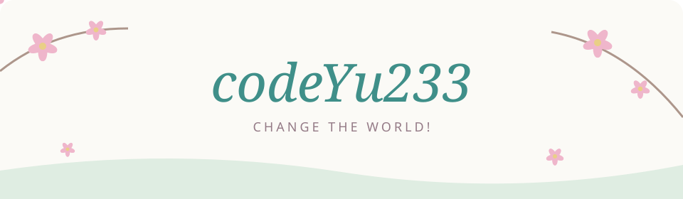

  

 

### 🌸 Hi there, I'm codeYu233

An undergraduate student in **Artificial Intelligence at UESTC**, expected to graduate in **2026**.

I explore **multimodal learning, large models, and embodied AI**, with the goal of bringing AI closer to the real world.

I believe intelligence grows through perceiving and interacting with the world. My aspiration is to build AI that connects understanding with action.

**Perceive · Understand · Interact**

🌱 [My blog](https://codeyu233.life/) · [GitHub](https://github.com/codeYu233)

 

### 🌷 A thought behind the journey

Why pursue multimodal and embodied intelligence? Here is my philosophical perspective on AI and its future:

[对现今 AI 的哲学理解和对其未来方向的探究 →](https://www.codeyu233.life/2024/11/10/对现今AI的哲学理解和对其未来方向的探究/)

 

  <picture>
    <source media="(prefers-color-scheme: dark)" srcset="https://raw.githubusercontent.com/codeYu233/codeYu233/output/github-contribution-grid-snake-dark.svg" />
    
  </picture>

 

🌱 A little about my GitHub activity

 

  

[Explore my repositories →](https://github.com/codeYu233?tab=repositories)

 

  
   
  Small steps, a wider world. 🌸

